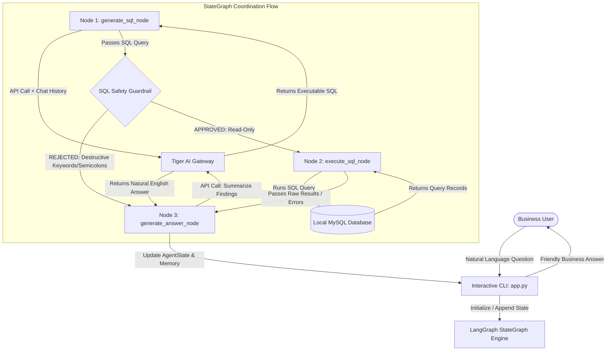

# System Architecture Diagram & Description

This document outlines the architectural components of the secure **Retail SQL Analyst Agent**, detailing how the LangGraph StateGraph, security guardrails, memory tracking, and local database interface.

---

## 1. System Flowchart (Mermaid)

---

## 2. Core Architectural Components

### A. The State Machine (`src/graph.py` & `src/memory.py`)
Our architecture is orchestrated using **LangGraph's StateGraph**, coordinating three sequential nodes:
1. **`generate_sql_node`**: Leverages the Tiger AI Gateway to translate user questions into database queries. By feeding the past turn logs into the LLM context, it maintains absolute state awareness across follow-up queries.
2. **`execute_sql_node`**: Acts as the gatekeeper. It executes the query against our MySQL server using `mysql-connector-python` but only after receiving authorization from our safety guardrail.
3. **`generate_answer_node`**: Synthesizes the raw data array returned by the database back into standard natural English. It logs the final output to history to preserve running session memory.

### B. The SQL Safety Guardrail Middleware (`src/safety.py`)
A critical non-negotiable security layer positioned between the generator node and the execution tool. It performs a three-tiered passive parsing check:
- **Command Validation**: Ensures every query starts strictly with a read-only token (`SELECT` or `WITH` for Common Table Expressions).
- **Destructive Keyword Interception**: Uses case-insensitive regex parsing to block structural modification commands (`DROP`, `DELETE`, `TRUNCATE`, `ALTER`, `UPDATE`, `INSERT`).
- **Semicolon-Injection Guard**: Cleans trailing semicolons and checks for embedded semicolons to prevent stacked statement execution.

### C. Relational Data Layer (`database/`)
A structured MySQL database containing five highly normalized synthetic retail tables:
- **`stores`**: Operational retail outlets (primary keys, region, city, type).
- **`products`**: Product catalog details (ID, name, categorization, base pricing).
- **`customers`**: Buyer segments, preferred sales channels, and sign-up dates.
- **`sales_transactions`**: The transactional log linking stores, products, and customers with pricing, units sold, and delivery statuses.
- **`returns`**: Tracking refunded transactions with structured reason mapping.

---

## 3. Human-in-the-Loop Safeguards
To ensure enterprise safety, our system prints the generated SQL query and database execution status directly on the console screen for developers to verify in real-time. This balance of automation and visual review matches industrial-level development practices.
